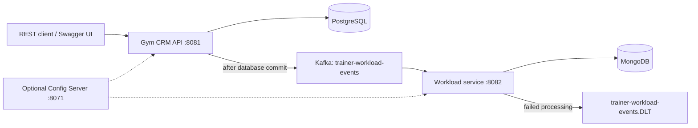

# Gym CRM

A Java backend for managing gym members, trainers, training sessions, and monthly trainer workloads. Originally built during the **EPAM Java Lab internship**, then modernized as a portfolio project with a reproducible build, documented APIs, and database and messaging integration tests.

## What it does

- Register trainees and trainers with generated credentials; log in to receive a signed JWT.
- Manage profiles, passwords, activation, and trainee–trainer assignments, including clearing assignments.
- Schedule sessions, retrieve them by ID, search your sessions with bounded pagination, and cancel them as the assigned trainer.
- Filter sessions by inclusive date range, trainer, trainee, and training type.
- Aggregate trainer workload by year and month in a separate MongoDB-backed service, fed by Kafka events.
- Retry failed workload processing and send exhausted or business-invalid events to a dead-letter topic.
- Explore the API through Swagger UI, with validation errors returned as RFC 9457 problem details.

This repository contains REST services. There is no browser frontend.

## Stack

| Component                 | Version / role                                                                           |
| ------------------------- | ---------------------------------------------------------------------------------------- |
| Java                      | **25**, compiled with `--release 25`; no preview features                                |
| Spring Boot               | **4.1.2**                                                                                |
| Spring Cloud              | **2025.1.4**; optional Config Server and Consul discovery                                |
| springdoc-openapi         | **3.2.0**                                                                                |
| Persistence               | Spring Data JPA, Hibernate, PostgreSQL, Flyway; H2 for the standalone demo               |
| Messaging and projections | Spring Kafka with Jackson 3 JSON serialization; Spring Data MongoDB                      |
| Security                  | RSA-signed JWTs, issuer validation in the CRM API, BCrypt passwords, login rate limiting |
| Testing                   | JUnit, Mockito, MockMvc, Cucumber, Testcontainers, Awaitility                            |
| Build                     | Maven Wrapper **3.10.0**, one reactor for all modules                                    |

Virtual threads are enabled for both HTTP services. The application also uses records, sealed request types, exhaustive switches, and Java's unnamed lambda variables. Records and sealed types predate Java 25; the upgrade does not depend on preview APIs.

Version compatibility: [Spring Boot requirements](https://docs.spring.io/spring-boot/system-requirements.html), [Spring Cloud release trains](https://spring.io/projects/spring-cloud/), [springdoc compatibility](https://springdoc.org/).

## Project documentation

- [Architecture decisions and Fowler/EIP pattern review](docs/architecture.md)
- [Naming and documentation conventions](docs/code-conventions.md)
- [Verified dependency/image versions and upgrade procedures](docs/upgrades.md)

## Architecture



| Module                                            | Responsibility                                                                                             |
| ------------------------------------------------- | ---------------------------------------------------------------------------------------------------------- |
| [`gym-crm-api`](gym-crm-api/)                     | Trainee, trainer, and training REST API; authentication; relational persistence; workload event production |
| [`gym-crm-common`](gym-crm-common/)               | Shared event contract, topic names, and JWT role conversion                                                |
| [`gym-crm-workload`](gym-crm-workload/)           | Kafka consumer, MongoDB workload projection, workload REST API                                             |
| [`gym-crm-config-server`](gym-crm-config-server/) | Optional classpath-backed Spring Cloud Config Server                                                       |

The root `pom.xml` owns dependency versions and builds every module in dependency order. The core service's source now lives in `gym-crm-api/src`, rather than the repository root.

## Quick start: standalone API

Requires **JDK 25**. Maven is downloaded by the wrapper. Docker is only needed for the full test suite or container-based startup.

```bash
java -version
./mvnw -DskipTests package
java -jar gym-crm-api/target/gym-crm-api-1.0.0-SNAPSHOT.jar
```

The default API profile is `standalone`: H2, no Config Server, no Consul, and workload event publishing disabled. It seeds `CARDIO`, `STRENGTH`, `FLEXIBILITY`, and `HIIT` training types. Accounts and sessions are created through the API. All demo data resets when the application stops.

- Swagger UI: <http://localhost:8081/swagger-ui.html>
- OpenAPI JSON: <http://localhost:8081/v3/api-docs>
- Health: <http://localhost:8081/actuator/health>

Alternatively, run just the standalone API in Docker:

```bash
docker compose -f docker-compose.standalone.yml up --build
```

The workload service needs MongoDB and Kafka; use the full stack to demonstrate it.

## Try the training workflow

Register a trainee and trainer. Save each response's `username` and `password`.

```bash
curl -sS http://localhost:8081/api/trainees \
  -H 'Content-Type: application/json' \
  -d '{"firstName":"Chris","lastName":"Miller"}'

curl -sS http://localhost:8081/api/trainers \
  -H 'Content-Type: application/json' \
  -d '{"firstName":"Dana","lastName":"Ford","specialization":"CARDIO"}'
```

Log in using the trainer's returned credentials:

```bash
curl -sS http://localhost:8081/api/auth/login \
  -H 'Content-Type: application/json' \
  -d '{"username":"Dana.Ford","password":"<generated trainer password>"}'
```

Copy `accessToken` into `TRAINER_TOKEN`. Repeated registrations get a numeric username suffix, so use the actual returned usernames. Dates must be today or later.

```bash
export TRAINER_TOKEN='<accessToken>'

curl -i http://localhost:8081/api/trainings \
  -H "Authorization: Bearer $TRAINER_TOKEN" \
  -H 'Content-Type: application/json' \
  -H 'X-Transaction-Id: demo-session-1' \
  -d '{"traineeUsername":"Chris.Miller","trainerUsername":"Dana.Ford","trainingName":"Cardio Blast","trainingDate":"2999-01-10","trainingDuration":45}'

curl -sS 'http://localhost:8081/api/trainings?trainingType=CARDIO&page=0&size=20' \
  -H "Authorization: Bearer $TRAINER_TOKEN"

# Replace 1 with the ID returned by session creation.
curl -sS http://localhost:8081/api/trainings/1 \
  -H "Authorization: Bearer $TRAINER_TOKEN"

curl -i -X DELETE http://localhost:8081/api/trainings/1 \
  -H "Authorization: Bearer $TRAINER_TOKEN"
```

Creation returns **201**, a `Location` header, and the session details including its ID. Cancellation returns **204**. Only the assigned trainer may create or cancel a session, and only its trainer or trainee can retrieve it through the training API. Search always scopes results to the authenticated participant.

## Full stack

```bash
docker compose -f docker-compose.full.yml up --build
```

This starts PostgreSQL, MongoDB, Kafka, the CRM API, and the workload service. The `docker` profiles connect directly to the infrastructure; Config Server and Consul are disabled. Database volumes persist across restarts. Both application images run as a non-root user on a digest-pinned Temurin 25.0.5 runtime. The full stack pins PostgreSQL 18.6, MongoDB 9.0.4, and Kafka 4.4.0. For an existing database volume, follow the [database upgrade procedure](docs/upgrades.md#existing-database-volumes) before changing server majors.

The workload API and Swagger UI are on port **8082**. After scheduling a training, use the trainer token at `GET /api/trainers/workload/Dana.Ford` to inspect the asynchronously updated monthly summary.

For running the services from your IDE with Config Server and Consul, start `docker-compose.dev.yml`, run `gym-crm-config-server`, and select the `dev` profile in both services. Install the reactor once with `./mvnw -DskipTests install` before running individual modules. Run configurations should use JDK 25 and the appropriate module classpath.

## API overview

| Endpoint                                             | Access / behavior                                                  |
| ---------------------------------------------------- | ------------------------------------------------------------------ |
| `POST /api/auth/login`                               | Public; returns `accessToken`; default limit 10 requests/minute/IP |
| `POST /api/trainees`, `POST /api/trainers`           | Public registration; returns generated credentials                 |
| `GET /api/training-types`                            | Public reference catalog                                           |
| `GET/PUT/DELETE /api/trainees/{username}`            | Authenticated trainee management                                   |
| `GET/PUT /api/trainers/{username}`                   | Authenticated trainer management                                   |
| `PUT /api/{trainees\|trainers}/{username}/password`  | Change password using current password                             |
| `PATCH /api/{trainees\|trainers}/{username}/active`  | Activate/deactivate; repeated state returns 409                    |
| `GET /api/{trainees\|trainers}/{username}/trainings` | Legacy unpaginated profile-specific session lists                  |
| `GET /api/trainees/{username}/unassigned-trainers`   | Available trainers                                                 |
| `PUT /api/trainees/{username}/trainers`              | Replace assignments; `[]` clears them                              |
| `PUT /api/password`                                  | Shared password change endpoint                                    |
| `POST /api/trainings`                                | Assigned trainer; 201 + session + `Location`                       |
| `GET /api/trainings/{id}`                            | Session participant; 200 or 404; unrelated users receive 403       |
| `GET /api/trainings`                                 | Your sessions; filterable, paginated                               |
| `DELETE /api/trainings/{id}`                         | Assigned trainer; 204 or 404                                       |
| `GET /api/trainers/workload/{username}`              | Trainer role; 200 or 404, served by workload service               |

Search parameters: `from`, `to` (ISO dates, inclusive), `traineeUsername`, `trainerUsername`, `trainingType`, `page` (zero-based), and `size` (1–100, default 20). Results sort by date descending, then ID descending for stable pagination. The response contains `content`, `page`, `size`, `totalElements`, and `totalPages`.

Training durations must be 1–480 minutes. New passwords must be 12–72 characters; generated passwords are 16 characters. API errors use `application/problem+json`, with field errors in `errors` where available. CRM requests receive an `X-Transaction-Id` response header for log correlation; safe incoming IDs are preserved and passed to Kafka as `transactionId`.

## Persistence and messaging

The relational model uses joined user inheritance, trainee–trainer assignments, and sessions referencing a trainee, trainer, and training type. Hibernate soft deletion uses `is_active`; inactive accounts are excluded from normal queries and cannot log in. Deletion should not be interpreted as a personal-data erasure guarantee.

Flyway migrations live in `gym-crm-api/src/main/resources/db/migration`. The persistent `dev`, `docker`, and `prod` setups validate the schema instead of recreating it. PostgreSQL repository and Cucumber tests exercise these migrations. The standalone H2 demo uses Hibernate schema creation and is not a replacement for migration testing.

Workload events are keyed by trainer username to preserve per-trainer Kafka partition ordering. They are sent **after** the relational transaction commits. The workload service stores monthly totals in MongoDB, with optimistic locking. Processing errors reach the Kafka error handler: transient processing failures get three retries, then a `.DLT` publish; invalid decoded events go directly to `.DLT`. Failed DLT publication throws so recovery can be retried. Operators must inspect and replay dead-letter events after correcting the underlying issue.

## Tests and CI

```bash
# Complete build: unit, HTTP, PostgreSQL, MongoDB, and Kafka tests; requires Docker.
./mvnw verify

# Unit tests and the H2 HTTP workflow, without Docker-backed suites.
./mvnw '-Dtest=*Test,!*RepositoryTest,!RunCucumberTest' \
  -Dsurefire.failIfNoSpecifiedTests=false test

# Build deployable jars without running tests.
./mvnw -DskipTests package
```

The HTTP workflow tests register users, issue real JWTs, schedule and find sessions, enforce participant access, and cancel sessions. PostgreSQL tests cover query behavior, schema validation, filtering, and pagination. Cucumber suites cover registration, training management, workload aggregation, and the Kafka-to-MongoDB integration. Surefire runs `*Test`; Failsafe runs `*IT` during `verify`.

Dependabot checks Maven, Dockerfile, and GitHub Actions updates weekly. GitHub Actions runs the full reactor on JDK 25 with Docker and uploads test reports. Reports also live in each module's `target/surefire-reports` and `target/failsafe-reports`.

## Configuration and project boundaries

Local JWT keys are bundled for reproducible development. `scripts/generate-dev-keys.sh` regenerates the matching API keystore and workload public key if needed. These are development keys. Persistent production configuration uses environment-provided database credentials, Kafka addresses, CORS origins, and external signing keys; see the `prod` documents under `gym-crm-config-server/src/main/resources/config`.

This remains a portfolio project with explicit follow-up work:

- Event production has an after-commit failure window. A transactional outbox and idempotent workload event processing are needed for durable end-to-end delivery; Kafka redelivery can currently double-count events.
- Dead-letter handling covers decoded event processing. Malformed JSON needs a deserialization recovery policy before accepting untrusted producers.
- The new training API enforces participant ownership. Legacy profile and workload endpoints still use broader authenticated/role access and need a complete member/staff authorization model.
- Existing JWTs remain valid until expiry after password changes or account deactivation. Refresh-token rotation and revocation are not implemented.
- Sessions are date-based. Timeslots, room capacity, conflict detection, attendance, memberships, and billing are outside the current model.
